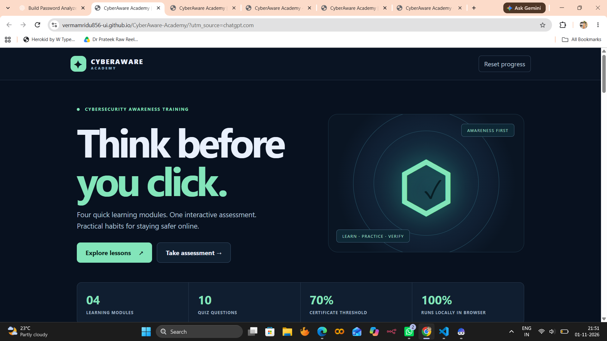
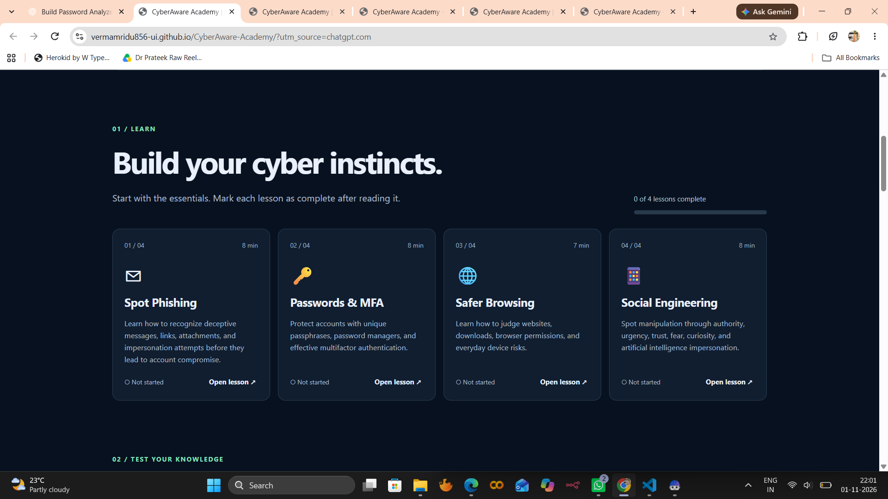
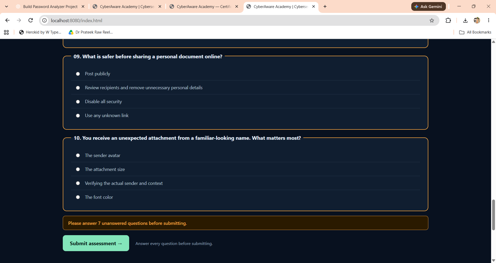
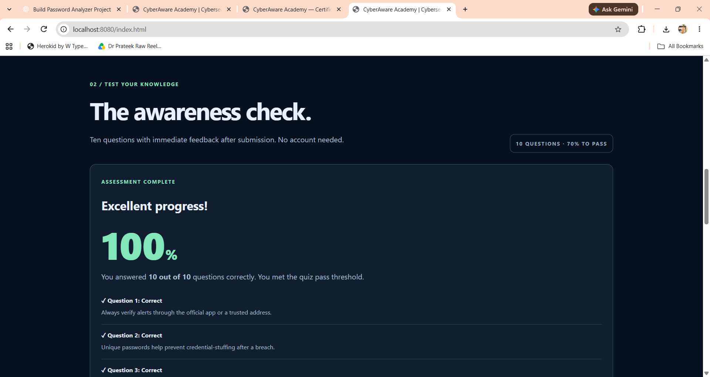
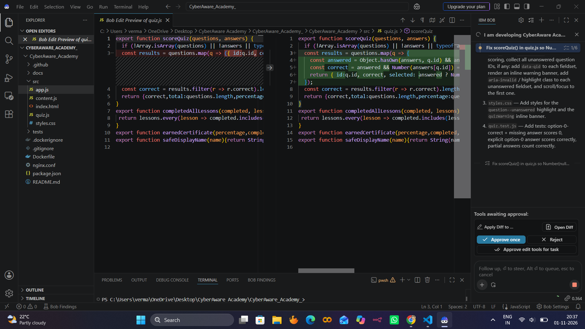
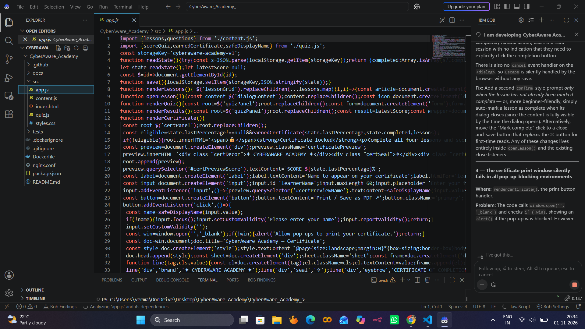
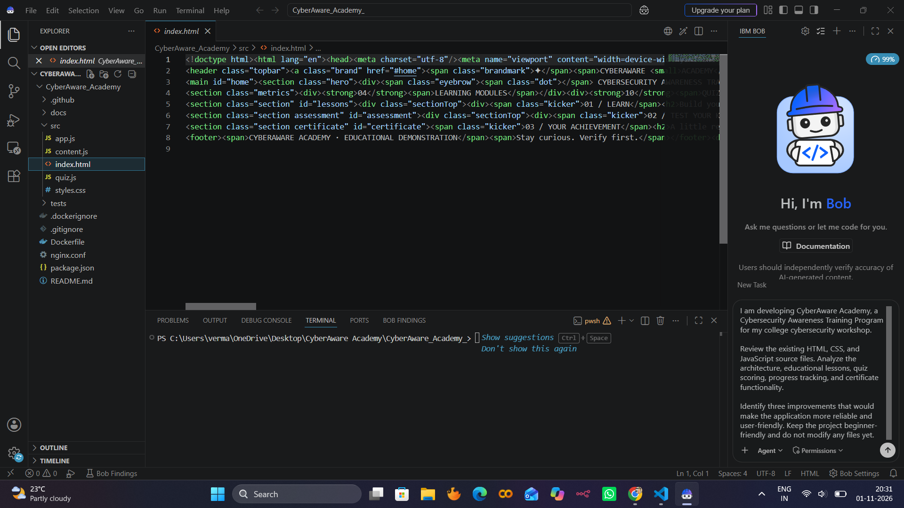
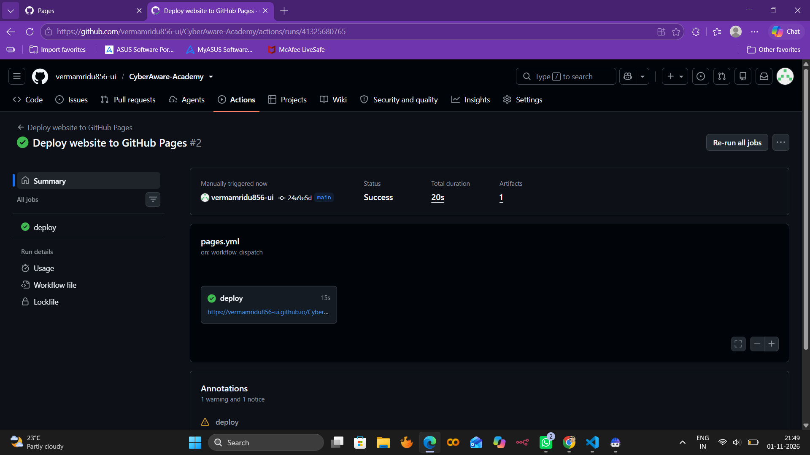

# CyberAware Academy

**Cybersecurity Awareness Training Program**  
IBM ICT Academy Cybersecurity Workshop · Educational Project

[](https://github.com/vermamridu856-ui/CyberAware-Academy/actions/workflows/pages.yml)
[](https://github.com/vermamridu856-ui/CyberAware-Academy/actions/workflows/tests.yml)

🌐 **Live site:** <https://vermamridu856-ui.github.io/CyberAware-Academy/>  
📁 **Repository:** <https://github.com/vermamridu856-ui/CyberAware-Academy>

---

## Table of Contents

1. [Project Overview](#1-project-overview)
2. [Problem Statement and Objectives](#2-problem-statement-and-objectives)
3. [Key Features](#3-key-features)
4. [Result Tracking — Google Forms and Google Sheets](#4-result-tracking--google-forms-and-google-sheets)
5. [System Architecture and Workflow](#5-system-architecture-and-workflow)
6. [Technology Stack](#6-technology-stack)
7. [Source-Code Folder Structure](#7-source-code-folder-structure)
8. [Local Installation and Execution](#8-local-installation-and-execution)
9. [Testing](#9-testing)
10. [IBM Bob — Debugging and Improvements](#10-ibm-bob--debugging-and-improvements)
11. [Screenshots](#11-screenshots)
12. [Deployment](#12-deployment)
13. [Known Limitations and Future Improvements](#13-known-limitations-and-future-improvements)

---

## 1. Project Overview

CyberAware Academy is a fully client-side cybersecurity awareness training platform built as part of the **IBM ICT Academy Cybersecurity Workshop**. It presents four short learning modules covering the most common human-layer threats, follows them with a ten-question interactive assessment, tracks lesson progress in the browser, and unlocks a printable completion certificate for learners who finish all modules and score at least 70 %.

The application runs entirely in the browser with no account, no back-end server, and no data sent to any server during normal use. After completing the quiz, a single optional "Record my result" button opens a pre-filled Google Form so the learner can voluntarily submit their score for participation tracking.



---

## 2. Problem Statement and Objectives

### Problem Statement

Phishing, weak passwords, unsafe browsing habits, and social-engineering manipulation are among the most common entry points for cyber attacks. Introductory cybersecurity training is often inaccessible, too lengthy, or insufficiently engaging for non-technical audiences. A concise, self-contained, and freely deployable training tool can close this gap at low cost.

### Objectives

| # | Objective |
|---|-----------|
| 1 | Deliver four concise, scenario-based learning modules on the core human-layer threats. |
| 2 | Measure understanding with a ten-question multiple-choice assessment and immediate explanatory feedback. |
| 3 | Enforce a 70 % pass threshold before unlocking a printable completion certificate. |
| 4 | Persist lesson progress and quiz scores locally in the browser across page reloads. |
| 5 | Collect participation data through Google Forms / Google Sheets without requiring a back-end. |
| 6 | Deploy the finished site automatically via GitHub Actions to GitHub Pages at zero cost. |
| 7 | Demonstrate use of IBM Bob (Plan, Agent, and Ask modes) as an AI-assisted development workflow. |

---

## 3. Key Features

### 3.1 Four Cybersecurity Learning Modules

Each module opens in a modal dialog, presents six bullet-point teaching notes, and closes with a real-world scenario and a model response. After reading, the learner clicks **Mark lesson complete** to record their progress.

| Module | Icon | Reading time | Topics covered |
|--------|------|-------------|----------------|
| **Spot Phishing** | ✉ | 8 min | Domain inspection, urgency tactics, unexpected attachments, credential safety, reporting |
| **Passwords & MFA** | 🔑 | 8 min | Unique passwords, passphrases, password managers, MFA, OTP protection |
| **Safer Browsing** | 🌐 | 7 min | HTTPS limitations, lookalike domains, trusted downloads, updates, shared devices |
| **Social Engineering** | 📱 | 8 min | Pretexting, baiting, AI-generated impersonation, verification through trusted channels |



### 3.2 Ten-Question Assessment

The assessment section renders all ten questions simultaneously. Each question belongs to a category (Phishing, Passwords, MFA, Browsing, Social Engineering, Device Safety, Privacy) and offers four radio-button answer choices.

### 3.3 Quiz Validation

Before scoring, the application validates that every question has been answered. Unanswered questions are highlighted with an amber border and a warning banner is displayed above the submit button. The page scrolls smoothly to the first unanswered question.



### 3.4 Scoring and 70 % Pass Threshold

The scoring formula is:

```
percentage = round( correct_answers / total_questions × 100 )
```

After submission, each question shows a **✓ Correct** or **✕ Review needed** label together with an explanatory sentence. A score of 70 % or higher is considered a pass.



### 3.5 Progress Tracking

Completed lesson IDs and the most recent quiz percentage are stored in the browser using `localStorage` under the key `cyberaware-academy-v1`. A progress bar in the lessons section updates in real time. Progress persists across page reloads but is local to the browser; clicking **Reset progress** clears it with a confirmation dialog.

### 3.6 Printable Certificate

A completion certificate is unlocked only when **all four lessons are marked complete** and the **most recent quiz score is at least 70 %**. The learner enters their name, sees a live preview update, and clicks **Print / Save as PDF** to open a landscape-formatted print dialog. The certificate records the score, four modules completed, and the issue date.

> **Note:** This is an educational workshop acknowledgement, not an accredited professional certification.

---

## 4. Result Tracking — Google Forms and Google Sheets

### How it works

After completing the quiz, a **Record my result** button appears below the score breakdown. Clicking it opens a pre-filled Google Form in a new tab.

The URL is assembled by `buildFormUrl()` in `src/quiz.js` using `URLSearchParams`. The function encodes four Google Forms entry IDs:

| Entry ID | Field | Populated from |
|----------|-------|----------------|
| `entry.419242921` | Quiz score (%) | `result.percentage` |
| `entry.1892569905` | Student name | Passed explicitly when available |
| `entry.1061860108` | Student ID | Passed explicitly when available |
| `entry.1878979011` | Certificate earned | `yes` / `no` based on full eligibility check |

The app calls `buildFormUrl({ percentage, certificateEarned })` — student name and ID fields are optional and are omitted from the URL when not provided, keeping the form fields blank for the learner to fill in themselves.

### Manual form submission

The learner reviews the pre-filled form, adds any missing information (name, student ID), and submits. Submissions are collected automatically in the linked **Google Sheets** spreadsheet, providing the instructor with a timestamped log of participation without requiring any server infrastructure.

The form URL base is:  
`https://docs.google.com/forms/d/e/1FAIpQLScbPQJ8rkW_aDY-qFvNSAp3qbCDHXdGaeN6YkPgNOLSCUWggQ/viewform`

---

## 5. System Architecture and Workflow

```
┌─────────────────────────────────────────────────────────────┐
│                        Learner Browser                       │
│                                                              │
│  ┌────────────┐   ┌─────────────┐   ┌────────────────────┐  │
│  │ index.html │──▶│   app.js    │──▶│  quiz.js           │  │
│  │ styles.css │   │  (UI logic) │   │  scoreQuiz()       │  │
│  └────────────┘   │  localStorage│  │  earnedCertificate()│  │
│                   │  renderLessons│  │  buildFormUrl()    │  │
│                   │  renderQuiz() │  └────────────────────┘  │
│                   │  renderResults│                          │
│                   │  renderCert() │  ┌────────────────────┐  │
│                   └──────────────┘  │  content.js        │  │
│                        │            │  lessons[]          │  │
│                        │            │  questions[]        │  │
│                        │            └────────────────────┘  │
└────────────────────────┼────────────────────────────────────┘
                         │ Optional: "Record my result"
                         ▼
              ┌──────────────────────┐
              │    Google Forms      │
              │  (pre-filled URL)    │
              └──────────┬───────────┘
                         │ on submit
                         ▼
              ┌──────────────────────┐
              │   Google Sheets      │
              │  (instructor view)   │
              └──────────────────────┘
```

### Page flow

```
Homepage / Hero
    │
    ├─▶ Lessons section (01 / LEARN)
    │       ├─ Open lesson modal → read content → mark complete
    │       └─ Progress bar updates (localStorage)
    │
    ├─▶ Assessment section (02 / TEST YOUR KNOWLEDGE)
    │       ├─ Select one answer per question
    │       ├─ Validate all answered (highlight unanswered)
    │       ├─ Submit → scoreQuiz() → renderResults()
    │       └─ "Record my result" → pre-filled Google Form (new tab)
    │
    └─▶ Certificate section (03 / YOUR ACHIEVEMENT)
            ├─ Locked: not all lessons done OR score < 70 %
            └─ Unlocked: enter name → print/save PDF
```

---

## 6. Technology Stack

| Layer | Technology | Role |
|-------|-----------|------|
| **Structure** | HTML5 | Single-page application shell (`src/index.html`) |
| **Presentation** | CSS3 | Dark-theme responsive layout, animations, print styles (`src/styles.css`) |
| **Logic** | Vanilla JavaScript (ES modules) | Lesson rendering, quiz scoring, certificate generation, localStorage, form-URL construction (`src/app.js`, `src/quiz.js`, `src/content.js`) |
| **Local server** | Python 3 `http.server` | Serves `src/` over HTTP for local development; required because ES modules cannot load from `file://` URLs |
| **Alternative local server** | Node.js `npx serve` | `npm start` launches `serve src -l 8080`; requires Node ≥ 20 |
| **Containerisation** | Docker + Nginx 1.27-alpine | Production-grade static serving on port 80; includes security headers |
| **AI development tool** | IBM Bob | Plan, Agent, and Ask modes used for code review, quiz-usability improvement, and viva preparation |
| **CI / CD** | GitHub Actions | Two workflows: automated JavaScript tests on every push/PR; automatic deployment to GitHub Pages on push to `main` |
| **Hosting** | GitHub Pages | Serves the `src/` folder; free, no configuration required beyond enabling the Actions source |
| **Result collection** | Google Forms | Pre-filled via URL parameters; opened in a new tab after quiz submission |
| **Result storage** | Google Sheets | Linked response spreadsheet automatically receives all form submissions |

---

## 7. Source-Code Folder Structure

```
CyberAware_Academy_/
│
├── src/                        # Application source (deployed to GitHub Pages)
│   ├── index.html              # Single HTML page — full application shell
│   ├── styles.css              # Dark-theme CSS, responsive layout, print styles
│   ├── content.js              # ES module: lessons[] and questions[] data
│   ├── quiz.js                 # ES module: scoreQuiz, earnedCertificate,
│   │                           #            safeDisplayName, buildFormUrl
│   └── app.js                  # ES module: UI rendering, localStorage, event wiring
│
├── tests/
│   └── quiz.test.js            # 40+ unit tests (Node built-in test runner)
│
├── docs/
│   ├── PROJECT_REPORT.md       # Academic project report template
│   └── IBM_BOB_WORKFLOW.md     # IBM Bob evidence checklist and prompts
│
├── screenshots/
│   ├── homepage.png            # Application homepage
│   ├── lessons.png             # Lessons section with progress bar
│   ├── quiz-validation.png     # Unanswered-question validation warning
│   ├── quiz-result.png         # Post-submission score and feedback
│   ├── github-deployment.png   # GitHub Actions deployment evidence
│   ├── ibm-bob-analysis.png    # IBM Bob Plan-mode analysis
│   ├── ibm-bob-debugging.png   # IBM Bob Agent-mode code edit (session 1)
│   ├── ibm-bob-debugging-2.png # IBM Bob Agent-mode code edit (session 2)
│   └── certificate.pdf         # Sample printed certificate
│
├── .github/
│   └── workflows/
│       ├── pages.yml           # Deploy src/ to GitHub Pages on push to main
│       └── tests.yml           # Run npm test on every push and pull request
│
├── Dockerfile                  # Nginx 1.27-alpine static server (port 80)
├── nginx.conf                  # Nginx server block with security headers
├── package.json                # npm scripts: start (serve) and test
├── .gitignore
├── .dockerignore
└── README.md
```

---

## 8. Local Installation and Execution

### Prerequisites

No installation is required for the simplest method. For Node.js-based methods, Node.js 20 or later is needed.

### Method 1 — Python built-in server (no installation required)

```bash
# From the project root
python -m http.server 8080 --directory src
```

On Windows, use `py` if `python` is not recognised:

```bash
py -m http.server 8080 --directory src
```

Open <http://localhost:8080> in your browser.

> **Important:** ES modules cannot load from `file://` URLs. Always use an HTTP server rather than opening `src/index.html` directly.

### Method 2 — VS Code Live Server extension

Install the **Live Server** extension in VS Code, right-click `src/index.html`, and choose **Open with Live Server**.

### Method 3 — Node.js `npm start`

```bash
npm start
```

This runs `npx serve src -l 8080`. Open <http://localhost:8080>.

### Method 4 — Docker

```bash
docker build -t cyberaware-academy .
docker run --rm --name cyberaware-demo -p 8081:80 cyberaware-academy
```

Open <http://localhost:8081>. Stop the container with **Ctrl + C**.

The Docker image uses Nginx 1.27-alpine with `X-Content-Type-Options: nosniff` and `Referrer-Policy: no-referrer` headers.

---

## 9. Testing

### Automated unit tests

The project uses the **Node.js built-in test runner** (available since Node 18; this project targets Node ≥ 20). No third-party testing framework is required.

```bash
npm test
# Equivalent: node --test tests/*.test.js
```

The test file `tests/quiz.test.js` contains **40 + tests** across five categories:

| Category | What is tested |
|----------|---------------|
| **Core scoring** | 100 % for all correct; 0 % for all wrong; 50 % for one of two; empty question list; result array length |
| **Lesson completion** | `completedAllLessons` with full and partial completion arrays |
| **Certificate eligibility** | `earnedCertificate` blocked at 69 %; blocked with incomplete lessons; unlocked at exactly 70 % with all lessons |
| **Name sanitisation** | `safeDisplayName` strips HTML angle brackets; enforces 60-character limit |
| **Null / unanswered answers** | Unanswered question does not score even when `correct` index is `0`; `null` value treated as unanswered; `selected` field is `null` for unanswered |
| **`buildFormUrl`** | URL starts with correct form base; `entry.419242921` carries rounded percentage; optional fields omitted when absent; `yes`/`no` encoding for certificate; `RangeError` for invalid percentages; URL-encoding of special characters; all four entry IDs present when all fields supplied |

### GitHub Actions CI

The workflow `.github/workflows/tests.yml` runs `npm test` on Node 22 for every push and every pull request. A failed test blocks the deployment workflow.

### Manual testing checklist

- Open all four lesson modals; verify content renders and **Mark lesson complete** updates the progress bar.
- Try to submit the quiz with unanswered questions; verify the amber highlight and warning banner appear and the page scrolls to the first unanswered question.
- Answer all questions and submit; verify the score, correct/incorrect indicators, and explanations render correctly.
- Score ≥ 70 % with all lessons complete; verify the certificate section unlocks, the name preview updates live, and the print dialog opens.
- Click **Reset progress**; confirm the confirmation dialog appears and progress clears.
- Click **Record my result**; verify a new tab opens with the Google Form pre-filled with the correct score.

---

## 10. IBM Bob — Debugging and Improvements

IBM Bob was used across three sessions during development.

### Session 1 — Plan mode: code review and improvement planning

**Prompt used:**
> Review this CyberAware Academy project. Explain how `src/content.js`, `src/quiz.js` and `src/app.js` work together. Identify two manageable improvements that will make the learning platform more robust. Create a plan only; do not edit code.

Bob analysed the three source files, identified the data-flow between `content.js` (data), `quiz.js` (logic), and `app.js` (rendering), and proposed two concrete improvements:

1. **Quiz validation** — highlight unanswered questions individually rather than blocking silently.
2. **Null-answer scoring guard** — ensure that a question whose correct answer is option index `0` cannot be unintentionally scored as correct when left unanswered.



### Session 2 — Agent mode: implementing quiz validation

**Prompt used:**
> Implement one small improvement to quiz usability or accessibility. Add a clearer error prompt when users try to submit unanswered questions. Keep all features working. Add or update an appropriate test where practical, run `npm test`, and explain changes.

Bob edited `src/app.js` to add unanswered-question detection with amber-border highlighting and a `role="alert"` warning banner, and added the `.question--unanswered` and `.quizWarning` CSS rules to `src/styles.css`. Corresponding unit tests were added to `tests/quiz.test.js` to cover the null-answer edge cases.



### Session 3 — Agent mode: Google Forms integration and `buildFormUrl`

Bob implemented the `buildFormUrl()` function in `src/quiz.js`, wrote 27 unit tests covering every parameter combination, edge case, and error path, and added the **Record my result** UI block in `src/app.js` along with the matching CSS in `src/styles.css`.



### Session 4 — Ask mode: viva preparation

**Prompt used:**
> Explain the quiz scoring function, browser localStorage behavior, certificate eligibility checks, and why this app requires no backend. Prepare five viva questions and answers based on the actual files.

Bob provided detailed explanations of `scoreQuiz`, the `cyberaware-academy-v1` localStorage key, the dual conditions in `earnedCertificate`, and the architectural rationale for a fully static deployment.

### Git evidence

Changes implemented with Bob's assistance are committed to the `main` branch. The commit history and GitHub Actions test results serve as evidence of the AI-assisted workflow.

---

## 11. Screenshots

| Screenshot | Description |
|------------|-------------|
|  | Application homepage with hero section and metrics strip |
|  | Four lesson cards with progress bar |
|  | Amber-border highlight and warning banner for unanswered questions |
|  | Score display with per-question feedback and "Record my result" button |
|  | GitHub Actions deployment workflow completing successfully |
|  | Bob Plan-mode project analysis |
|  | Bob Agent-mode quiz-validation implementation |
|  | Bob Agent-mode Google Forms integration |

---

## 12. Deployment

### GitHub Pages (live)

The site is deployed automatically via the workflow `.github/workflows/pages.yml`:

- **Trigger:** any push to the `main` branch, or a manual `workflow_dispatch`.
- **Process:** checks out the repository, configures GitHub Pages, uploads `src/` as the Pages artifact, and deploys it.
- **URL:** <https://vermamridu856-ui.github.io/CyberAware-Academy/>

Deployment typically completes within 60 seconds. The **Actions** tab in the repository shows the live status of each run.


### Deploying your own fork

1. Fork or clone the repository.
2. Push to a repository on your GitHub account.
3. Go to **Settings → Pages → Source** and select **GitHub Actions**.
4. Push any commit to `main` to trigger deployment.
5. Your site will be available at `https://YOUR_USERNAME.github.io/REPO_NAME/`.

---

## 13. Known Limitations and Future Improvements

### Known limitations

| Limitation | Detail |
|-----------|--------|
| **Browser-local progress only** | Lesson completion and quiz scores are stored in `localStorage`. Clearing the browser or switching devices resets all progress. |
| **No identity verification** | The certificate is generated from a name the learner types themselves; no authentication takes place. |
| **Single quiz attempt recorded** | Only the most recent quiz percentage is stored. Earlier attempts are overwritten. |
| **Manual form submission** | The Google Form opens in a new tab and must be submitted manually; the application cannot confirm whether the learner submitted it. |
| **No central analytics** | There is no dashboard or aggregate reporting; results are visible only in the linked Google Sheets spreadsheet. |
| **Educational scope** | The certificate is a workshop participation acknowledgement, not an accredited professional certification. |

### Future improvements

| Area | Proposed enhancement |
|------|---------------------|
| **Content** | Multilingual support; role-specific question banks for students, staff, and administrators. |
| **Assessment** | Randomised question order and answer shuffling to discourage memorisation. |
| **Progress** | Cloud-based progress sync (e.g., via an authenticated serverless function) so learners can continue across devices. |
| **Analytics** | Instructor dashboard with pass-rate charts drawn directly from the Google Sheets response data. |
| **Accessibility** | Full keyboard navigation audit; ARIA live regions for dynamic content updates; screen-reader testing. |
| **Certification** | Optional QR-code verification link on the certificate to allow employers or institutions to confirm completion. |

---

<sub>CyberAware Academy · IBM ICT Academy Cybersecurity Workshop · Educational demonstration · Not an accredited certification</sub>
